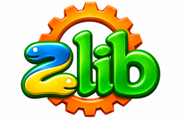

# zlib-rust



Python bindings for the Trifecta Tech Foundation's
[`zlib-rs`](https://github.com/trifectatechfoundation/zlib-rs), a fast Rust
implementation of zlib.

The foundation develops and maintains zlib-rs as part of its
[data compression initiative](https://trifectatech.org/initiatives/data-compression/).
The compression engine, its optimizations, and its Rust API are their work.
This package brings that work to Python, with a familiar interface and
installable wheels, independently of the library your Python distributor chose.

## How to use

```console
pip install zlib-rust
```

The public API follows Python's standard-library `zlib` module. The package
imports as `zlib_rust`, so switching your own code is explicit:

```python
import zlib_rust as zlib

compressed = zlib.compress(b"hello")
assert zlib.decompress(compressed) == b"hello"
```

Streaming compression and decompression use `compressobj()` and
`decompressobj()`. Raw DEFLATE, zlib, and gzip streams are supported through
the usual `wbits` parameter. Streaming decompression supports `max_length`
to bound the output of each call.

For gzip files, use the familiar `GzipFile` and `open()` interfaces:

```python
from zlib_rust.gzip import GzipFile

with GzipFile("events.gz", "wb") as stream:
    stream.write(b"hello\n")
```

The file-handling code comes from CPython's gzip module, using zlib-rs for
compression, decompression, and checksums. Both checksum-combine functions
are available on every supported Python version.

The binding forbids unsafe Rust and releases the GIL during codec operations.
Package versions follow the pinned zlib-rs crate version.

`__version__` identifies this Python package; `ZLIB_RS_VERSION` identifies the
pinned Rust engine. `ZLIB_VERSION` and `ZLIB_RUNTIME_VERSION` follow zlib-rs's
[`zlibVersion()` convention](https://github.com/trifectatechfoundation/zlib-rs/blob/v0.6.9/libz-rs-sys/src/lib.rs#L2122-L2158):
`1.3.0-zlib-rs-0.6.9` identifies both its zlib API compatibility level and its
Rust release. They are equal because the engine is linked into the wheel;
there is no separately loaded zlib library or C header version.
Python 3.16's `zlib_version` alias and four-field `ZLIB_VERSION_INFO` and
`zlib_version_info` named tuples are also available on older Python versions.

CPython's unrelated, fixed `zlib.__version__ == "1.0"` is
[deprecated from Python 3.15](https://docs.python.org/3.15/whatsnew/3.15.html#deprecated).
It is not the compression library's version. This independently released
package keeps its own version in `__version__` without that deprecation.

## Development

Install Rust 1.85 or newer and Python 3.11 or newer. Build a wheel with
`maturin build --release --locked`, install it into your development
environment, then run `pytest`.

This package was built with heavy use of LLMs. Its tests combine CPython's
zlib and gzip suites with interoperability tests against the standard-library
codec and tests for the Python binding. Imported tests retain their
[source references and documented adaptations](tests/upstream/cpython/SOURCE.md).

The Trifecta Tech Foundation's work makes this package possible. You can
[support the foundation](https://trifectatech.org/support/) to help sustain
zlib-rs and its other public-interest infrastructure projects.

## Alternatives (Python 3.16, conditions apply)

From Python 3.16 onwards you can also use zlib-rs through Python's
standard-library `zlib` module.  CPython 3.16 adds a [`--with-zlib=zlib-rs`
build option](https://docs.python.org/3.16/using/configure.html#cmdoption-with-zlib).

That's great, but Python 3.16 doesn't exist yet, and you'd depend on the
choices of your Python distributor (often: Linux distributions, container
images, or Python installers).

This package lets you select zlib-rs for your own code while using an existing
Python installation, including older Python versions.
